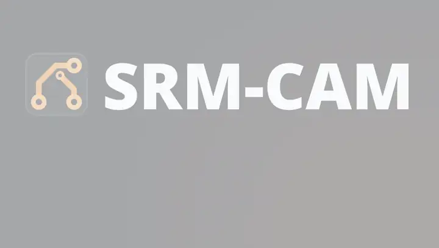
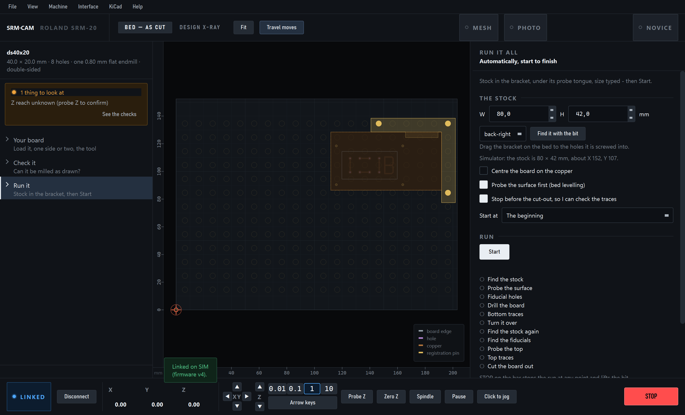
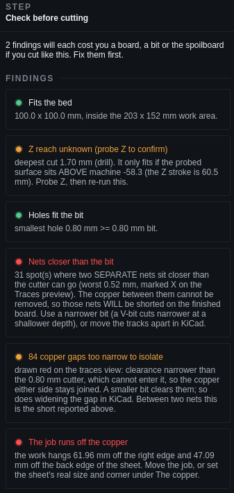
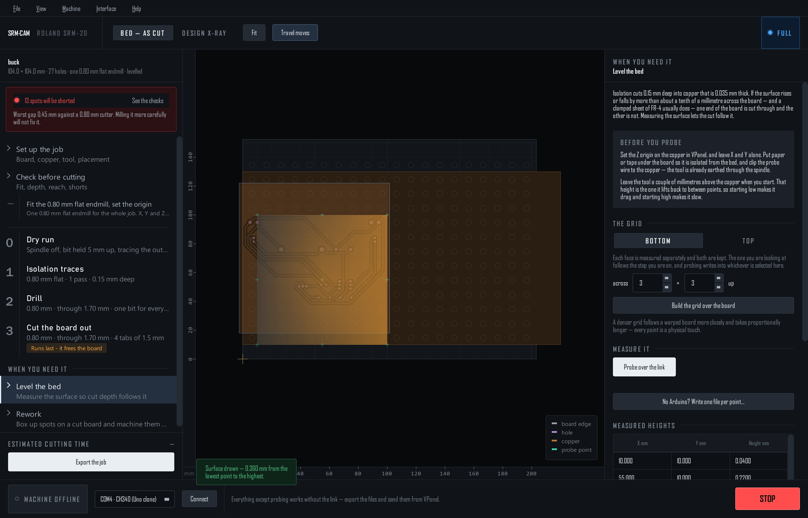
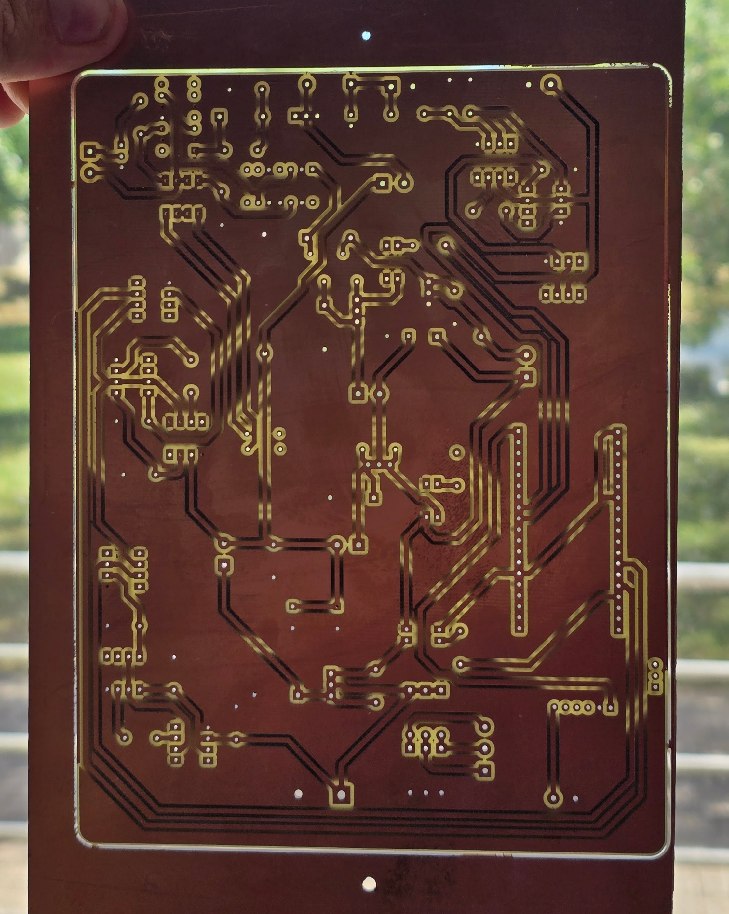
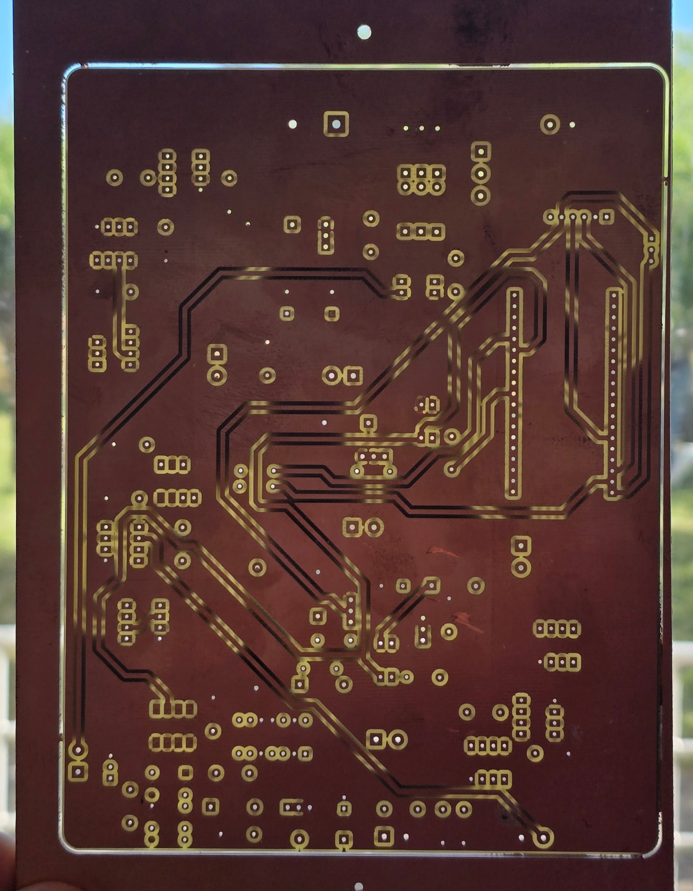

# SRM-CAM

[](https://github.com/MadsRudolph/srm-cam/actions/workflows/tests.yml)
[](https://github.com/MadsRudolph/srm-cam/actions/workflows/build.yml)

CAM for the Roland SRM-20 desktop mill. Load a KiCad board's Gerber and drill
files, check the toolpaths, and mill the PCB: one or two sides, with bed
levelling, from a single program.

**User guide: [madsrudolph.github.io/srm-cam](https://madsrudolph.github.io/srm-cam/)**

| Start here | Then |
|---|---|
| [Getting started](https://madsrudolph.github.io/srm-cam/getting-started.html) | [Double-sided boards](https://madsrudolph.github.io/srm-cam/double-sided.html) |
| [Mill a board](https://madsrudolph.github.io/srm-cam/automatic.html) | [Bed levelling](https://madsrudolph.github.io/srm-cam/bed-leveling.html) |
| [Holding the copper](https://madsrudolph.github.io/srm-cam/holding-the-copper.html) | [Several boards on one sheet](https://madsrudolph.github.io/srm-cam/panels.html) |
| [Troubleshooting](https://madsrudolph.github.io/srm-cam/troubleshooting.html) | [Solder mask](https://madsrudolph.github.io/srm-cam/solder-mask.html) |

[](https://madsrudolph.github.io/srm-cam/video/srm-cam-showcase.mp4)

## Download

| Platform | File | |
|---|---|---|
| Windows | `SRM-CAM-Setup.exe` | Unsigned: on the first run, SmartScreen needs *More info ▸ Run anyway*. |
| macOS (Apple Silicon) | `SRM-CAM-macOS-arm64.dmg` | Not notarised: right-click ▸ Open the first time. See [docs/macos.md](docs/macos.md). |
| Linux | `SRM-CAM-x86_64.AppImage` | `chmod +x` and run. Drives the mill too: once, *Machine ▸ Set up USB access…* (asks for your password). No VPanel or driver needed. |

All from the [latest release](https://github.com/MadsRudolph/srm-cam/releases/latest).

**Before first use on Windows**, install Roland's **monoFab driver** from the
[SRM-20 download page](https://downloadcenter.rolanddg.com/SRM-20#software)
(Software tab). It is the one thing SRM-CAM needs: the driver makes the mill a
printer SRM-CAM can send to. Install it with the mill's USB unplugged, and plug
it in when the installer asks. Roland's VPanel is optional: only for playing
exported files by hand in Pro, or for changing the mill's command set.
Step by step: [Getting started](https://madsrudolph.github.io/srm-cam/getting-started.html#roland).

## What it does



- **One method per board:** flat mill, ball mill or laser copper, read from KiCad or guessed from the board's gaps, and yours to change. It decides the checks, the tool and the jobs on the rail.
- **One rail for both machines.** A laser board is drilled and cut out on its tabs on the mill, then the whole sheet goes to the laser for the copper, the mask and the silkscreen, lined up on the drilled holes.
- **Automatic runs.** Put the stock in the corner bracket and press Start: it finds the copper, levels the bed, drills, cuts the traces, and stops for a check before the cut-out. [Mill a board](https://madsrudolph.github.io/srm-cam/automatic.html)
- **[Double-sided boards](https://madsrudolph.github.io/srm-cam/double-sided.html)**, registered on dowel pins or reference holes (drilled ones, or the board's own mounting holes).
- **[Bed levelling](https://madsrudolph.github.io/srm-cam/bed-leveling.html).** The surface is probed and the cut depth follows it.
- **[Clamps](https://madsrudolph.github.io/srm-cam/holding-the-copper.html).** Click the bed hole a clamp is screwed into; the run keeps the bit off it and goes round it.
- **Boards as big as the sheet.** Left in the sheet with no cut-out, with isolation under the bracket or a clamp dropped only when that joins no nets.
- **Checks** before anything is cut: fits the bed, Z reach, shorts, copper, screws.
- **[Panels](https://madsrudolph.github.io/srm-cam/panels.html), [rework](https://madsrudolph.github.io/srm-cam/photo-and-rework.html) and [export](https://madsrudolph.github.io/srm-cam/reference.html)** to G-code (`.nc`) or RML for VPanel, in *Pro* mode.
- **xTool F1 Ultra laser page** for solder paste stencils, solder mask and silkscreen from the same Gerbers.
- **KiCad plugin.** Shows the SRM-20's build area in the PCB editor, sets design rules for the way the board is made (flat mill, ball mill or laser), and sends the board to SRM-CAM.

**Novice** (the default) is the automatic run. **Pro** is the same run with every control open: the stock anywhere (the probe finds its corner), every step on the rail, and export for VPanel. Click the tier chip at the top right to switch.
Automatic runs need an Arduino on the mill's SPI header ([Hardware & firmware](https://madsrudolph.github.io/srm-cam/hardware.html));
without it, SRM-CAM exports files for VPanel like any other CAM tool.

### Videos

- [Mill a board](https://youtu.be/rVPFPnBHoaY): from a KiCad folder to a finished board
- [Double-sided](https://youtu.be/nmh9I9FdkqI)
- [Pro mode, by hand](https://youtu.be/aab9ItDjwt0)

<table>
<tr>
<td width="50%"><br><sub>Checks, with the worst finding kept on the rail.</sub></td>
<td width="50%"><br><sub>A probed surface, one map per face.</sub></td>
</tr>
<tr>
<td width="50%"><br><sub>A double-sided board: bottom.</sub></td>
<td width="50%"><br><sub>And top, held to the light.</sub></td>
</tr>
</table>

## From source

```bash
pip install -e ".[gui]"
python -m gerber2rml.gui2                                    # the app
python -m gerber2rml.cli <gerber-folder> -o out -n <board>   # command line
python -m gerber2rml.doctor                                  # after a git pull: new dependencies
pytest
```

The Python package is `gerber2rml`. The older interface still ships as
`python -m gerber2rml.gui` (or `SRM-CAM --original`); both use the same engine
and write the same files.

## Documentation

| | |
|---|---|
| [User guide](https://madsrudolph.github.io/srm-cam/) | How to use it: start here |
| [docs/usage.md](docs/usage.md) | Full reference: every setting, presets, the CLI |
| [docs/macos.md](docs/macos.md) | macOS: the mill as a print queue, its settings without VPanel |
| [kicad-plugin/](kicad-plugin) | The KiCad plugin |
| [packaging/README.md](packaging/README.md) | Building the installers, cutting a release |
| [MAINTAINING.md](MAINTAINING.md) | Keeping it running: locked builds, CI, handover |
| [DTU PCB prototyping](https://github.com/DTU-EKB/DTU-PCB-prototyping#making-pcbs-with-the-roland-cnc-router) | The lab's step-by-step guide, with photos |

## Credits

By Mads Vølkers Rudolph. macOS support, the mill's settings without VPanel and
the clamp zones by Marius Bjerregaard. MIT licence.
